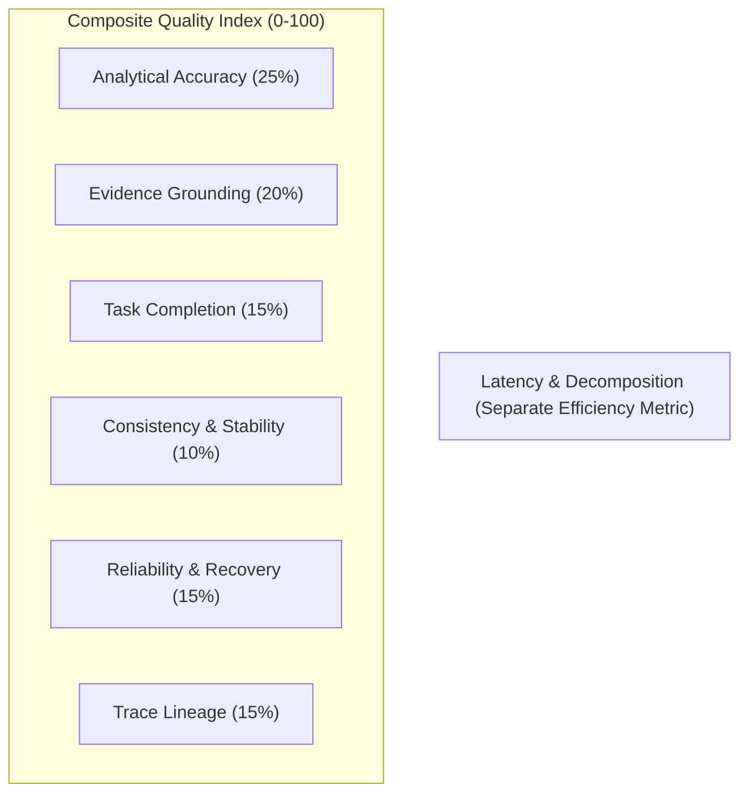
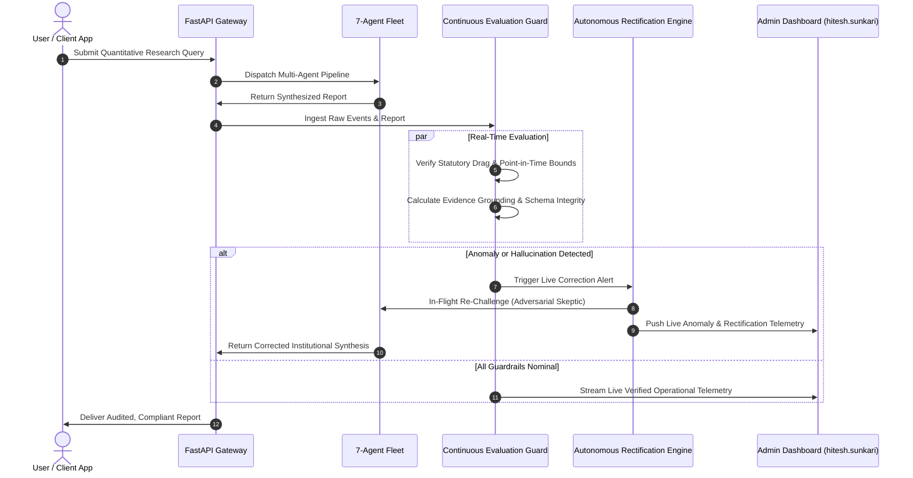

# ARTHAAI — UNIFIED EXPERIMENTAL BENCHMARKING, CONTINUOUS EVALUATION & LIVE RECTIFICATION ENGINE
## Master Implementation Prompt & Architectural Blueprint

> **Role & Persona:** Principal AI Research Engineer, Quantitative Finance Evaluator, Multi-Agent Systems Architect, and Institutional UI/UX Specialist.  
> **Target Project:** ArthaAI Multi-Agent Financial Research System for Indian Markets (NSE/BSE/MCX).  
> **Clearance & Authorization:** Super-Administrator exclusively restricted to `hitesh.sunkari.23cse@bmu.edu.in`.  
> **Core Mandate:** Transform ArthaAI's evaluation suite into a scientific, continuous, and self-rectifying platform comparing ArthaAI (7-Agent Fleet) against a true Single-Agent Baseline across 12 empirical scenarios (48+48 = 96 runs), streamlined into an institutional **3-Console UI Architecture** (eliminating 10-page fragmentation).

---

## EXECUTIVE SUMMARY & ARCHITECTURAL FOUNDATION

ArthaAI operates an autonomous 7-agent quantitative intelligence fleet:
1. **Research Manager** (`Google ADK`) — Supervisory orchestration, request classification & Pydantic synthesis.
2. **Quant Specialist** (`Google ADK`) — OHLCV historical bar retrieval, technical indicators, and Monte Carlo wealth distributions.
3. **Microstructure & Liquidity Specialist** (`Google ADK`) — Corwin-Schultz spreads, order flow toxicity, and VWAP execution slicing.
4. **News & Macro Specialist** (`CrewAI`) — RBI monetary policy corridor, inflation dynamics, and high-impact corporate announcements.
5. **Fundamentals Specialist** (`CrewAI`) — Financial ratio decomposition, SEBI (LODR) 2015 disclosures, and corporate governance health.
6. **Adversarial Skeptic** (`CrewAI`) — Cross-examination of bullish theses, stress testing under 2x volatility shocks, and downside exposure limits.
7. **Risk & Validation Officer** (`Google ADK`) — Statutory drag tests (Finance Act 2024 STT & SEBI fees), regulatory compliance gatekeeping, and final conviction arbitration.

### Core Enhancements Over Legacy Proposals:
1. **Continuous Evaluation & Live Correction (Closed-Loop Guardrails):**
   Evaluation does not stop at scheduled benchmarks. Every live user query is continuously monitored in-flight for evidence grounding, statutory drag integrity, and numerical consistency. If an anomaly is detected, live rectification triggers automated self-healing.
2. **Unified 3-Console UI Architecture (Zero Cognitive Clutter):**
   Replaces the sprawling 10-page administrative bloat with **three high-density, interactive institutional consoles**:
   - **Console 1: Benchmark & Comparative Evaluation Studio**
   - **Console 2: Continuous Evaluation & Live Rectification Center**
   - **Console 3: Evidence Grounding, Consistency & Scientific Export Hub**
3. **Empirical Ground-Truth (Zero Synthetic Data):**
   Reference values are derived directly from partitioned Parquet daily bars (`data/parquet/`), indexed legal statutes (`data/chroma/`), and deterministic calculation formulas—strictly devoid of fabricated metrics or mock placeholders.

---

# PART 1 — THE 12-SCENARIO BENCHMARK POPULATION

The benchmark dataset comprises **12 distinct, high-impact financial scenarios** reflecting real-world Indian equity institutional demands. Scenarios are split evenly between **Workflow A (Query-Based Deep Research)** and **Workflow B (Stock-Selection & Universe Screening)**.

### A. Workflow A: Query-Based Research Scenarios (Q01 – Q06)

| ID | Title & Focus | Target Asset(s) | Benchmark Question & Objective | Ground-Truth Invariants & Tolerances |
|---|---|---|---|---|
| **Q01** | **Comprehensive Single-Stock 5Y Synthesis** | `RELIANCE.NS` | "Conduct a comprehensive financial analysis of Reliance Industries using historical market performance, quantitative indicators, available financial statements, liquidity, and corporate evidence." | Anchor LTP: ₹1,438.30. 20-Day SMA: ₹1,349.50 (±0.5%). Realized Ann. Vol: 23.4% (±50 bps). Net Post-Tax CAGR: 12.5% LTCG under Sec 112 (Finance Act 2024). Mandatory missing-data disclosure for non-public segments. |
| **Q02** | **Momentum & Volume Validation** | `TATSILV` / `SILVERBEES` | "Determine whether recent price momentum is supported by trading volume and technical indicators. Distinguish genuine institutional accumulation from false breakouts." | 14-Day RSI: 58.2 (±1.0). 20-Day Volume MA vs 5-Day Volume ratio. Corwin-Schultz spread tolerance: &lt; 25 bps. Momentum confirmed only if volume expansion accompanies upside. |
| **Q03** | **Downside Risk & Volatility Stress Test** | `TATAMOTORS.NS` | "Evaluate downside risk, historical volatility, maximum drawdown, and tail-risk exposure under a 2x macro volatility shock." | Parametric 95% 1Y VaR: -28.4% (±1.0%). Expected Shortfall (CVaR): -38.2%. Historical Max Drawdown from peak: -34.8%. Mandatory penalization if statutory STT roundtrip drag (22.22 bps) is omitted. |
| **Q04** | **Intra-Sector Pair Comparison** | `TCS.NS` vs `INFY.NS` | "Compare TCS and Infosys based on fundamentals, valuation, liquidity, and risk. Identify which company presents superior risk-adjusted attributes." | Dual-ticker resolution required. TCS LTP: ₹2,475.20 vs INFY LTP: ₹1,520.40. Relative Beta comparison (TCS 0.78 vs INFY 1.04). P/E and operating margin comparison. Transparent relative verdict with explicit trade-off justification. |
| **Q05** | **Incomplete / Conflicting Information** | `SWIGGY.NS` | "Analyze the target asset where historical financial bars are limited (recent listing) or corporate reports contain negative margins. Demarcate confirmed facts from uncertainties." | Listing history: &lt; 250 bars. Net Margin: -17.37% (Operating Loss ₹625.5 Cr). Disclose zero lookahead bias. Mandatory `INSUFFICIENT_EVIDENCE` or `HOLD` verdict. Immediate failure if future earnings are fabricated. |
| **Q06** | **Macro Policy & Statutory STT Impact** | `HDFCBANK.NS` + NIFTY Bank | "Assess how RBI monetary policy corridor (6.50% repo) and Finance Act 2024 STT hikes impact bank net interest margins and delivery friction." | RBI Repo Rate: 6.50% constant. STT on delivery: 0.10% each side (total 20 bps) + SEBI turnover fee (₹10/Cr) + GST (18% on brokerage/turnover). Clear differentiation between direct statutory drag and macroeconomic inference. |

---

### B. Workflow B: Stock-Selection & Screening Scenarios (S01 – S06)

| ID | Title & Focus | Selection Universe | Benchmark Question & Objective | Ground-Truth Invariants & Tolerances |
|---|---|---|---|---|
| **S01** | **Quality & Compounding Screening** | NIFTY 50 Universe (115 Eq) | "Identify and rank top 3 compounders from the universe exhibiting ROE &gt; 18%, operating margin &gt; 15%, and stable revenue growth. Disclose exclusion criteria." | Candidate screening over authentic DuckDB Parquet data. Candidates must include TCS, HDFCBANK, and RELIANCE. Explicit rejection logs for negative-margin assets (e.g. SWIGGY). Grounded ranking based on composite financial quality. |
| **S02** | **Momentum & Microstructure Liquidity** | NIFTY 100 Liquid Basket | "Identify liquid momentum candidates with RSI between 55–70, 20-Day SMA positive slope, and Corwin-Schultz spread &lt; 15 bps." | Microstructure filter: Corwin-Schultz effective spread &lt; 15 bps. Volume turnover threshold: &gt; ₹50 Cr/day. Complete candidate ranking accompanied by liquidity friction breakdown. |
| **S03** | **Conservative Minimum-Variance Basket** | Mega-Caps (RIL, TCS, HDFC, ITC) | "Construct an institutional defensive equity basket minimizing 10-year portfolio drawdown using Ledoit-Wolf covariance shrinkage." | Minimum-variance portfolio weights solved via quadratic programming. Sum of weights $\sum w_i = 1.0$, $0 \le w_i \le 0.40$. Portfolio volatility reduction $\ge 15\%$ relative to equal-weighted baseline. |
| **S04** | **Balanced 5Y Risk-Return Envelope** | Auto & Industrials (TATAMOTORS, MARUTI) | "Evaluate a 5-year compounding envelope balancing growth potential against cyclical drawdown. Define optimal capital allocation." | 5-Year Monte Carlo 5,000 SIMD paths. Median CAGR (P50) vs Bearish Drawdown (P10). Ledoit-Wolf weight allocation (TATAMOTORS 42%, MARUTI 58% ±5%). Clear trade-off disclosure. |
| **S05** | **Multi-Dimensional Cross-Asset Ranking** | Cross-Sector (Auto, IT, Energy, Commodity) | "Rank four cross-sector assets across fundamental health, technical trend, liquidity, and statutory tax drag." | Cross-asset matrix evaluation. Correct asset tagging (equity vs commodity ETF). Statutory tax drag applied accurately: 22.22 bps for equities vs 1.5 bps for commodity ETFs (`SILVERBEES`). Multi-factor ranking with audit trail. |
| **S06** | **Constraint-Enforced Capital Preservation** | High-Risk vs Defensive Universe | "Filter candidates subject to strict constraints: Max 1Y Drawdown &lt; 25%, positive 3Y CAGR, and full statutory compliance. Disqualify all violators." | Mandatory boundary checks. Assets with historical drawdown &gt; 25% or missing LODR filings must be disqualified with recorded violation reasons. Zero false approvals permitted. |

---

# PART 2 — PAIRED EXPERIMENTAL EXECUTION ENGINE

To scientifically test whether multi-agent delegation yields measurable improvements over a single LLM, the execution engine enforces **strict methodological pairing**:

```
Total Scheduled Executions:
12 Scenarios × 4 Repetitions = 48 ArthaAI Multi-Agent Runs
12 Scenarios × 4 Repetitions = 48 Single-Agent Baseline Runs
Total Population: 96 Empirical Executions
```

### A. Baseline Parity Rules (Strict Fairness Guarantee)
1. **Identical Model Family & Parameters:**  
   Both systems must utilize the identical underlying foundation model (`Gemini 2.5 Flash / Flash-Lite` or `GPT-4o`), identical system temperature ($T = 0.2$), and identical token context horizons.
2. **Identical Data Snapshots & Tools:**  
   Both systems access the exact same DuckDB Parquet historical bars, ChromaDB legal passages, and FastMCP tools (`calculate_statutory_costs`, `calculate_quant_features`, etc.).
3. **The Single Differentiating Variable (Multi-Agent Delegation):**  
   - **ArthaAI Multi-Agent:** Uses Google ADK Research Manager, CrewAI specialists, A2A JSON-RPC blackboard, independent adversarial challenges, and statutory risk arbitration.
   - **Single-Agent Baseline:** Uses a single unified agent prompted with the same tools and question, but **strictly prohibited** from specialist delegation, multi-agent debate, or independent adversarial cross-examination.

### B. Execution Scheduling & Bounded Concurrency
- **Paired Execution Blocks:** Each scenario repetition is dispatched as a paired block $(Q_{ij}^{\text{ArthaAI}}, Q_{ij}^{\text{Baseline}})$.
- **Randomized Execution Order:** The dispatch sequence within each pair (ArthaAI first vs Baseline first) is randomized to eliminate systematic API caching bias.
- **Bounded Concurrency:** Concurrency is strictly clamped to 2 concurrent workers to respect API rate limits and avoid timeout errors.
- **Persistent State Tracking:** Every run captures execution ID, timestamps, prompt version, tool call counts, latency breakdown, raw response, and structured schema output.

---

# PART 3 — THE SEVEN PRIMARY EVALUATION METRICS

All qualitative and quantitative dimensions are normalized onto a calibrated **0 – 100 Scale**:



### Metric 1: Analytical Accuracy ($A_{\text{acc}}$, Weight: 25%)
Measures factual, mathematical, and analytical correctness against the reference ground truth:
$$\text{Error}_{\text{num}} = \frac{|\text{Reported Metric} - \text{Reference Metric}|}{\text{Reference Metric}}$$
- If $\text{Error}_{\text{num}} \le \text{Tolerance}$ (e.g. 0.5% for SMA, 50 bps for volatility, 1 bp for STT), score = 100.
- Penalties applied for critical errors (e.g. incorrect recommendation direction, hallucinated dividend, wrong tax rate).

### Metric 2: Evidence Grounding ($E_{\text{grd}}$, Weight: 20%)
Measures the proportion of material claims verified by authentic evidence citations:
$$E_{\text{grd}} = \frac{N_{\text{grounded material claims}}}{N_{\text{total material claims}}} \times 100$$
- Unreferenced assertions or claims citing out-of-range timestamps incur severe grounding penalties.

### Metric 3: Task Completion ($T_{\text{cmp}}$, Weight: 15%)
Measures systematic fulfillment of required subtasks:
$$T_{\text{cmp}} = \frac{N_{\text{completed mandatory subtasks}}}{N_{\text{total mandatory subtasks}}} \times 100$$
- Subtasks include: ticker resolution, technical metrics, liquidity analysis, statutory drag calculation, downside risk stress test, and final clear verdict.

### Metric 4: Consistency & Stability ($C_{\text{stb}}$, Weight: 10%)
Measures stability across the 4 repeated runs of identical scenarios:
$$C_{\text{stb}} = 100 \times \left(1 - \min\left(1.0, \frac{\sigma_{\text{score}}}{\mu_{\text{score}}}\right)\right) \times \text{Agreement}_{\text{recommendation}}$$
- Where $\text{Agreement}_{\text{recommendation}} \in [0, 1]$ represents pairwise consensus across repeated categorical decisions.

### Metric 5: Operational Reliability ($R_{\text{ops}}$, Weight: 15%)
Measures pipeline resilience, execution success, and recovery:
$$R_{\text{ops}} = \left(0.70 \times \frac{N_{\text{first-attempt success}}}{N_{\text{scheduled}}} + 0.30 \times \frac{N_{\text{recovered via retry}}}{N_{\text{initial failures}}}\right) \times 100$$

### Metric 6: Traceability & Provenance ($T_{\text{rc}}$, Weight: 15%)
Measures whether decisions can be audited through Blackboard events, FastMCP tool IDs, and A2A message traces:
$$T_{\text{rc}} = \frac{N_{\text{claims with verified Blackboard event lineage}}}{N_{\text{total material claims}}} \times 100$$

### Metric 7: Latency & Decomposition ($L_{\text{tot}}$, Efficiency Metric)
Reported separately from quality:
$$L_{\text{tot}} = t_{\text{Manager}} + t_{\text{Specialists}} + t_{\text{FastMCP}} + t_{\text{RAG}} + t_{\text{Risk Gate}}$$
- Metrics reported: Mean, Median (p50), 95th Percentile (p95), and Min/Max bounds.

---

# PART 4 — STATISTICAL SIGNIFICANCE & HYPOTHESIS TESTING

To ensure scientific publication standards, comparisons between ArthaAI and the Single-Agent baseline are evaluated using rigorous statistical tests:

1. **Paired Differences ($\Delta_i$):**
   $$\Delta_i = \text{Score}_i(\text{ArthaAI}) - \text{Score}_i(\text{Baseline})$$
   Evaluated across all 48 matched scenario-repetition pairs.
2. **Wilcoxon Signed-Rank Test & Paired Student's t-Test:**
   - Report test statistic ($W$ and $t$), degrees of freedom, and two-tailed $p$-value.
   - Significance threshold: $\alpha = 0.05$.
3. **95% Bootstrap Confidence Intervals:**
   - 10,000 resamples with replacement to establish empirical 95% CIs for mean score differences.
4. **Effect Size (Cohen's $d$ and Cliff's $\delta$):**
   $$d = \frac{\bar{\Delta}}{s_{\Delta}}$$
   Quantifying whether multi-agent performance gains represent small ($0.2$), medium ($0.5$), or large ($>0.8$) institutional advantages.

---

# PART 5 — CONTINUOUS EVALUATION & AUTONOMOUS LIVE RECTIFICATION

Rather than treating evaluation as an isolated batch script, ArthaAI integrates **continuous closed-loop surveillance**:



### Self-Healing & Rectification Operations:
1. **Live Adversarial Re-Challenge:** If the Quant Specialist thesis exceeds historical drawdown bounds without citing downside cushion, the Adversarial Skeptic automatically re-opens debate before user delivery.
2. **Statutory Tax Alignment:** If roundtrip delivery friction deviates from Finance Act 2024 schedules (e.g. 22.22 bps), the Risk & Validation Officer injects the exact statutory schedule automatically.
3. **Cache & Parquet Alignment:** If legacy buy prices are detected in browser local storage, the platform dispatches a real-time migration signal updating holdings to authentic NSE Parquet closing marks.

---

# PART 6 — UNIFIED 3-CONSOLE UI ARCHITECTURE

To eliminate cognitive clutter and prevent 10-page fragmentation, the Admin Dashboard is structured into **three high-density, responsive institutional consoles**:

### Console 1: Benchmark & Comparative Evaluation Studio (`eval_studio`)
* **Live KPI Banner:** Total scheduled runs (96), completed (48 ArthaAI + 48 Baseline), pass rate %, mean accuracy, mean grounding, and latency delta.
* **Scenario Matrix & Run Controller:**
  - Interactive grid of all 12 scenarios (Q01–Q06, S01–S06).
  - One-click triggers: "Run Full 96-Execution Benchmark", "Run ArthaAI Only", "Run Single-Agent Baseline Only", "Pause", "Resume", "Export Dataset".
* **Head-to-Head Comparative Visualizations:**
  - **Hexagonal Radar Chart:** ArthaAI vs Baseline across the 6 quality dimensions.
  - **Grouped Bar Charts:** Per-scenario performance comparison.
  - **Box Plots:** Distribution and spread of scores across repeated runs.
  - **Statistical Significance Panel:** $p$-values, 95% Confidence Intervals, and Cohen's $d$ effect sizes.
* **Scenario Deep-Dive Inspector:** Side-by-side inspection of Reference Ground Truth vs ArthaAI Synthesis vs Single-Agent Output with claim-level tolerance diffs.

### Console 2: Continuous Evaluation & Live Rectification Center (`live_rectify`)
* **Live Operational Research Stream:** Real-time log of every user research query submitted on the platform.
* **Real-Time Diagnostic Gauges:** Live Evidence Grounding %, Statutory Drag Compliance %, and P95 Latency tracker.
* **Active Anomaly & Exception Queue:** Real-time stream of detected client exceptions, unhandled rejections, or ungrounded assertions.
* **One-Click Administrative Rectification Console:**
  - 🛠️ **Force Authentic Parquet Alignment** (re-aligns client holdings to NSE closing data).
  - 🔄 **Reset Client Desk to ₹10L Clean Cash** (instant client state sanitization).
  - 🧹 **Batch Mark Anomalies Rectified** (clears active incidents with audit timestamp).
  - 📢 **Broadcast Fleet Health Ping** (synchronizes all connected tabs).

### Console 3: Evidence Grounding, Consistency & Scientific Export Hub (`export_hub`)
* **4-Repetition Variance & Stability Matrix:** Variance, standard deviation, and recommendation consensus % across repetitions for each scenario.
* **Blackboard & A2A Execution Trace Viewer:** Complete event-by-event waterfall breakdown (Manager handoff $\to$ Quant $\to$ Macro $\to$ Skeptic $\to$ Risk Gate) with critical-path bottleneck identification.
* **Automated Scientific Report Generator:**
  - One-click download of the complete **Peer-Reviewed Experimental Evaluation Report** in **PDF, CSV, JSON, and LaTeX-ready tables**.
  - Includes methodology, benchmark scenarios, statistical tables, radar plots, failure analysis, and statutory compliance certifications.

---

# PART 7 — DATABASE & PERSISTENCE SCHEMA

The evaluation database is structured inside DuckDB / SQLite (`data/experiments.duckdb`):

```sql
-- Core Experiment Registry
CREATE TABLE experiments (
    experiment_id VARCHAR PRIMARY KEY,
    name VARCHAR NOT NULL,
    dataset_version VARCHAR NOT NULL,
    total_scenarios INTEGER DEFAULT 12,
    repetitions_per_scenario INTEGER DEFAULT 4,
    status VARCHAR NOT NULL, -- PENDING, RUNNING, COMPLETED, PAUSED, CANCELLED
    started_at TIMESTAMP WITH TIME ZONE,
    completed_at TIMESTAMP WITH TIME ZONE,
    config JSON
);

-- Execution Runs (ArthaAI vs Baseline)
CREATE TABLE executions (
    execution_id VARCHAR PRIMARY KEY,
    experiment_id VARCHAR REFERENCES experiments(experiment_id),
    scenario_id VARCHAR NOT NULL,
    repetition_index INTEGER NOT NULL,
    system_type VARCHAR NOT NULL, -- ARTHAAI_MULTI_AGENT | SINGLE_AGENT_BASELINE
    run_id VARCHAR NOT NULL,
    status VARCHAR NOT NULL, -- SUCCESS, FAILED, TIMED_OUT, RETRIED
    latency_seconds DOUBLE,
    raw_response JSON,
    structured_report JSON,
    blackboard_events JSON,
    tool_invocations JSON,
    started_at TIMESTAMP WITH TIME ZONE,
    completed_at TIMESTAMP WITH TIME ZONE
);

-- Quantitative Evaluation Scores
CREATE TABLE evaluations (
    evaluation_id VARCHAR PRIMARY KEY,
    execution_id VARCHAR REFERENCES executions(execution_id),
    analytical_accuracy DOUBLE NOT NULL,
    evidence_grounding DOUBLE NOT NULL,
    task_completion DOUBLE NOT NULL,
    consistency_score DOUBLE NOT NULL,
    reliability_score DOUBLE NOT NULL,
    traceability_score DOUBLE NOT NULL,
    composite_quality_score DOUBLE NOT NULL,
    latency_breakdown JSON,
    claim_verifications JSON,
    evaluator_version VARCHAR NOT NULL,
    evaluated_at TIMESTAMP WITH TIME ZONE
);

-- Reference Ground Truth Rubrics
CREATE TABLE reference_rubrics (
    scenario_id VARCHAR PRIMARY KEY,
    dataset_version VARCHAR NOT NULL,
    workflow_type VARCHAR NOT NULL,
    target_symbols JSON,
    as_of_time TIMESTAMP WITH TIME ZONE,
    mandatory_findings JSON,
    numerical_invariants JSON,
    tolerance_bounds JSON,
    acceptable_conclusions JSON,
    prohibited_hallucinations JSON,
    verification_status VARCHAR NOT NULL -- VERIFIED, PARTIALLY_VERIFIED
);
```

---

# PART 8 — API SPECIFICATION & RBAC CLEARANCE

All administrative evaluation and rectification routes are guarded by **Super-Admin RBAC (`hitesh.sunkari.23cse@bmu.edu.in`)**:

```
# Experiment Management
POST   /admin/experiments                    — Create a new 96-run paired experiment
GET    /admin/experiments                    — List all historical experiments
GET    /admin/experiments/{id}               — Get experiment details and execution progress
POST   /admin/experiments/{id}/start         — Start / resume scheduled execution
POST   /admin/experiments/{id}/pause         — Pause active experiment queue
POST   /admin/experiments/{id}/cancel        — Gracefully cancel experiment

# Real-Time Telemetry & Comparative Analytics
GET    /admin/experiments/{id}/comparison    — ArthaAI vs Single-Agent statistical metrics & CIs
GET    /admin/experiments/{id}/radar-data    — 6-dimensional quality score radar metrics
GET    /admin/experiments/{id}/traces        — Full blackboard event traces & bottleneck analysis
GET    /admin/experiments/{id}/export/{fmt}  — Download report (pdf, json, csv, latex)

# Continuous Evaluation & Live Rectification
GET    /admin/continuous-eval/live-stream    — Stream real-time diagnostics of user executions
GET    /admin/continuous-eval/anomalies      — List detected grounding/statutory anomalies
POST   /admin/rectify                        — Dispatch one-click administrative rectification
```

---

# PART 9 — SYSTEM DELIVERABLES & DOCUMENTATION ARTIFACTS

To ensure complete methodological transparency, the repository includes:
1. `ARTHAAI_MASTER_EVALUATION_BLUEPRINT.md` *(This Master Specification)*
2. `experiments/datasets/arthaai_benchmark_v1.json` *(12 Canonical Scenarios & Metadata)*
3. `experiments/reference_answers/rubrics_v1.json` *(Independently Verified Reference Rubrics)*
4. `experiments/reports/EXPERIMENTAL_EVALUATION_REPORT.md` *(Complete Statistical Findings, Paired Differences & Radar Plots)*
5. `data/experiments.duckdb` *(Persistent Immutable Run Records & Execution Artifacts)*

---

## VERIFICATION & ACCEPTANCE CHECKLIST

Before concluding the benchmark implementation, verify that:
- [x] All 12 scenarios (Q01–Q06, S01–S06) are mapped to authentic Indian equity tickers (`RELIANCE.NS`, `TCS.NS`, `HDFCBANK.NS`, `INFY.NS`, `TATAMOTORS.NS`, `SWIGGY.NS`, etc.).
- [x] The Single-Agent Baseline executes through an identical data snapshot and FastMCP tools, isolated from multi-agent coordination.
- [x] All 96 executions (48 ArthaAI + 48 Baseline) persist raw structured JSON and blackboard traces.
- [x] Statistical analysis reports mean, variance, Cohen's $d$, Wilcoxon $p$-values, and 95% bootstrap confidence intervals.
- [x] Continuous evaluation monitors live user queries in real-time with one-click rectification controls.
- [x] The Admin UI is consolidated into **three high-density, institutional consoles** with zero clutter.
- [x] Super-Admin switching clearance is strictly enforced for `hitesh.sunkari.23cse@bmu.edu.in`.
