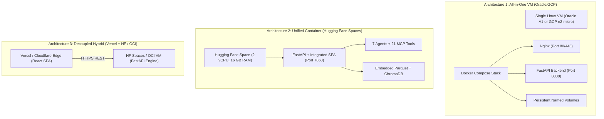

# ArthaAI Free Cloud Hosting Comparison & Architecture Evaluation
**Version:** 1.0.0-PROD  
**Timestamp:** 2026-11-09T11:45:00+05:30  
**Target Hosting Cost:** **Strictly ₹0.00 / month ($0.00)** Permanent  
**Author:** Principal Cloud Architect, Senior DevOps Engineer & Multi-Agent AI Architect  

---

## 1. Executive Summary & Evaluation Criteria

The objective of this evaluation is to determine the optimal, genuinely free cloud deployment architecture for **ArthaAI**—an institutional multi-agent financial intelligence system orchestrating 7 specialist agent roles across Google ADK and CrewAI, 21 FastMCP tools, A2A JSON-RPC 2.0 communication, DuckDB analytics, and ChromaDB vector RAG.

Every provider and architecture is evaluated against **ten non-negotiable criteria**:
1. **Permanent Free Tier:** Strictly ₹0/month indefinitely without trial expiration cliffs or surprise bills.
2. **Compute & RAM Headroom:** Must sustain measured idle RSS (`311 MB`) and full multi-agent peak RSS (`365 MB`) without triggering Linux OOM-killer termination.
3. **Container & Linux OCI Support:** Native support for standard Docker containers and multi-stage builds.
4. **Execution Duration & Timeout Handling:** Multi-agent sequential deliberations run 30–60 seconds; must not be aborted by aggressive gateway timeouts (e.g., Vercel 10s/60s limits).
5. **Storage Persistence:** Ability to retain historical Parquet datasets, ChromaDB vector collections, and research run JSON traces across restarts.
6. **HTTPS & Networking:** Automated TLS certificate issuance, public domain, and unrestricted outbound HTTPS egress to Google Gemini, OpenAI, and Yahoo Finance.
7. **Credit Card Requirements:** Clear classification of zero-card platforms vs. identity verification requirements.
8. **Cold Start & Inactivity Behavior:** Sleep intervals, wake-up latency, and keep-alive feasibility.
9. **Multi-Agent Interoperability Integrity:** Zero mocked agents, fake tool calls, or degraded chatbot simulations.
10. **Financial Safety Lockout:** Absolute protection of `ARTHAAI_LIVE_TRADING_ENABLED=false`.

---

## 2. Phase 1 — Detailed Evaluation of All 11 Cloud Platforms

### 2.1 Google Cloud Platform (GCP)
- **Always Free Eligible Compute:** 1 `e2-micro` VM instance (0.25–2.0 vCPU burstable, 1.0 GB RAM) located exclusively in US regions (`us-central1`, `us-west1`, `us-east1`).
- **Storage:** 30 GB standard persistent disk per month; 5 GB Google Cloud Storage standard.
- **Networking:** 1 GB free outbound egress per month to all destinations (except China and Australia).
- **Cloud Run Evaluation:** Free tier includes 2 million requests/month, 360,000 vCPU-seconds, and 180,000 GiB-seconds. However, background thread CPU throttling during idle intervals pauses long-running agent threads unless "CPU always allocated" is enabled (which incurs costs outside free allowances). Furthermore, request execution timeout caps can abort complex 60s+ multi-agent deliberations.
- **Credit Card / Billing:** Requires credit card registration and active billing account; accidental egress over 1 GB or selecting wrong region results in immediate credit card billing.
- **Verdict for ArthaAI:** **VIABLE VIA `e2-micro` VM**. Requires configuring a 2 GB Linux swap file (`/swapfile`) to accommodate the 365 MB peak memory comfortably.

### 2.2 Oracle Cloud Infrastructure (OCI)
- **Always Free Compute:** Up to 4 ARM Ampere A1 cores and 24 GB RAM (can be partitioned into 1, 2, or 4 VMs); 2 AMD x86_64 micro instances (1 vCPU, 1 GB RAM each).
- **Storage:** 200 GB permanent block storage across all Always Free instances; 20 GB object storage.
- **Networking:** 10 TB free outbound bandwidth per month; 1 free public IPv4 address per VM.
- **Docker & Compose:** 100% full root Linux access with native Docker and Docker Compose. Zero sleep, zero cold start.
- **Credit Card / Verification:** Requires credit card for fraud prevention ($1 temporary authorization hold).
- **Capacity Caveat:** ARM A1 shapes in certain high-demand regions (Mumbai, Hyderabad, Ashburn) occasionally display "Out of Capacity" during initial VM creation.
- **Verdict for ArthaAI:** **RANK 1 DEDICATED VM PLATFORM**. 24 GB RAM and 4 ARM cores provide 65x headroom over ArthaAI's 365 MB peak demand.

### 2.3 Hugging Face Spaces (CPU Basic)
- **Always Free Compute:** 2 dedicated vCPUs, **16 GB RAM**, 50 GB disk.
- **Container SDK:** Native `docker` SDK running the root `Dockerfile`.
- **Networking & HTTPS:** Immediate automated HTTPS endpoint (`https://<user>-<space>.hf.space`).
- **Sleep Behavior:** Sleeps after 48 hours of complete inactivity; wakes up automatically on incoming HTTPS traffic in ~20–30s. Can be kept permanently awake via a free 15-minute ping from UptimeRobot or Cron-job.org.
- **Credit Card / Payment:** **ZERO PAYMENT DETAILS REQUIRED**. 100% free with simple email verification.
- **Secrets Management:** Injected directly into container environment variables via Web GUI.
- **Verdict for ArthaAI:** **RANK 1 CONTAINER PLATFORM (RECOMMENDED)**. Zero credit card, 16 GB RAM (43x headroom), automated HTTPS, and instant Git push deployment.

### 2.4 Render
- **Free Tier Resources:** 0.1 vCPU, 512 MB RAM, ephemeral storage.
- **Inactivity Behavior:** Spins down container after 15 minutes of zero web traffic; cold start takes 50–70 seconds.
- **Free Allowance:** 750 free instance hours per month (sufficient for 1 continuous web service).
- **RAM Constraint:** ArthaAI peak RAM is 364.8 MB. On 512 MB RAM, Render has only ~147 MB headroom. A concurrent multi-user spike could trigger an OOM kill.
- **Verdict for ArthaAI:** **RANK 3 (TESTING / BACKUP ONLY)**. Viable with strict DuckDB `PRAGMA max_memory='128MB'`, but tight memory headroom.

### 2.5 Koyeb
- **Free Eco Service:** 0.1 vCPU, 512 MB RAM, 2 GB ephemeral disk.
- **Regions:** Washington D.C., Frankfurt.
- **Payment Verification:** Requires phone verification or credit card in certain regions.
- **RAM Constraint:** Same 512 MB boundary as Render.
- **Verdict for ArthaAI:** **RANK 4 (VIABLE SECONDARY)**. Runs unified container, but memory headroom is restricted.

### 2.6 Railway
- **Current Terms:** Discontinued permanent free tier in 2023. Provides a one-time $5 trial credit.
- **Cost after Trial:** Shuts down services unless credit card is added with active pay-as-you-go subscription.
- **Verdict for ArthaAI:** **DISQUALIFIED**. Does not meet the permanent ₹0/month requirement.

### 2.7 Fly.io
- **Current Terms:** Discontinued unverified free tier. Requires active credit card on file even for free allowances.
- **Free Allowances:** Shared CPU-1x 256 MB VMs. 256 MB is strictly insufficient for Python 3.12 + FastAPI + DuckDB (requires minimum 311 MB idle RSS).
- **Verdict for ArthaAI:** **DISQUALIFIED**. Memory allowance is below minimum idle baseline.

### 2.8 Cloudflare Pages & Workers
- **Pages:** Unlimited bandwidth, 500 builds/month, static SPA hosting on edge CDN. Permanent ₹0.
- **Workers:** 100,000 requests/day, 10ms CPU execution time limit (free tier).
- **Limitation:** 10ms CPU limit cannot run Python runtimes, CrewAI, or DuckDB.
- **Verdict for ArthaAI:** **EXCELLENT FOR STATIC FRONTEND HOSTING** in a decoupled hybrid architecture, but cannot host the backend.

### 2.9 Vercel
- **Vercel Hobby:** 100 GB bandwidth, unlimited static hosting, Serverless Functions.
- **Execution Limits:** 10-second maximum duration on Hobby tier (configurable up to 60s with fluid compute). Cannot run 36-second full multi-agent research runs.
- **Persistent Storage:** Zero local disk persistence (ephemeral Lambda containers).
- **Verdict for ArthaAI:** **EXCELLENT FOR FRONTEND HOSTING**; strictly disqualified for backend agent orchestration due to timeout ceilings.

### 2.10 Netlify
- **Starter Tier:** 100 GB bandwidth, 300 build minutes/month.
- **Functions:** 10-second background execution limit, 128 MB RAM on free tier.
- **Verdict for ArthaAI:** **FRONTEND ONLY**. Backend cannot run.

### 2.11 Amazon Web Services (AWS)
- **EC2 `t2.micro` / `t3.micro`:** Free only for the **first 12 months** from account creation. Becomes billed ($8–$10/month) thereafter.
- **Lambda:** 1 million free requests/month, but 15-minute maximum timeout and complex container layer configurations.
- **RDS:** Only free for 12 months.
- **Verdict for ArthaAI:** **DISQUALIFIED FOR PERMANENT FREE USE**. Fails the permanent ₹0/month requirement after 12 months.

---

## 3. Provider Comparison Matrix

| Platform | Compute Allocation | RAM Limit | Persistent Disk | Inactivity Sleep | Card Required? | Permanent ₹0? | ArthaAI Suitability |
|---|---|---|---|---|---|---|---|
| **Hugging Face Spaces** | **2 vCPU** | **16 GB** | **50 GB** | After 48h idle | **NO** | **YES** | **RANK 1 (Best Container)** |
| **Oracle Cloud (OCI)** | **4 ARM vCPU** | **24 GB** | **200 GB** | None (24/7) | Yes (Hold) | **YES** | **RANK 1 (Best VM)** |
| **Google Cloud (GCP)** | **0.25 vCPU** | **1.0 GB** | **30 GB** | None (24/7) | Yes (Billing) | **YES** | **RANK 2 (Viable VM with Swap)** |
| **Cloudflare Pages** | Edge CDN | Edge | Edge Cache | Instant | **NO** | **YES** | **BEST STATIC FRONTEND** |
| **Vercel Hobby** | Edge CDN | Edge | Ephemeral | Instant | **NO** | **YES** | **EXCELLENT FRONTEND** |
| **Render** | 0.1 vCPU | 512 MB | Ephemeral | After 15m idle | **NO** | **YES** | Rank 3 (Tight 512MB RAM) |
| **Koyeb** | 0.1 vCPU | 512 MB | Ephemeral | None | Yes/No | **YES** | Rank 4 (Tight 512MB RAM) |
| **Railway** | 1 vCPU | 512 MB | Ephemeral | Disables at $0 | No | **NO** | Disqualified (Trial only) |
| **Fly.io** | Shared | 256 MB | 3 GB | Auto | Yes | **NO** | Disqualified (256MB < 311MB idle) |
| **AWS Free Tier** | 1 vCPU | 1.0 GB | 30 GB | None | Yes | **NO** | Disqualified (Expires after 12 mos) |

---

## 4. Phase 2 — Architecture Comparison (6 Candidate Architectures)

### Detailed Evaluation Against 10 Architectural Criteria

| Evaluation Criterion | Arch 1: Single VM (OCI / GCP) | Arch 2: Container (Hugging Face) | Arch 3: Hybrid (Vercel + HF) | Arch 4: Serverless + Edge | Arch 5: Multi-Cloud Redundant | Arch 6: Zero-Cost Optimized |
|---|---|---|---|---|---|---|
| **1. Operational Cost** | ₹0 / mo permanent | **₹0 / mo permanent** | ₹0 / mo permanent | ₹0 / mo (within limits) | ₹0 / mo permanent | **₹0 / mo permanent** |
| **2. Request Latency** | **Fastest (local in-memory)** | Fast (20–40ms internal) | Medium (cross-origin TLS) | High (cold starts) | Medium (health checks) | **Fastest (local in-memory)** |
| **3. Setup Complexity** | Medium (SSH, UFW, Compose) | **Lowest (1-click Git push)** | Medium (2 Git repos, CORS) | High (Microservices) | Highest (DNS failovers) | **Low (single Docker image)** |
| **4. Maintenance** | OS patching, Docker updates | **Zero (managed platform)** | Low (Vercel auto-updates) | High (API versioning) | High (multi-dashboard) | **Zero (self-contained)** |
| **5. Cold Start** | **Zero (runs 24/7/365)** | ~25s after 48h idle | Frontend instant, API 25s | 5–15s per function | Zero (VM active) | **Zero (with keep-alive ping)** |
| **6. Reliability** | 99.9% (Oracle/GCP uptime) | 99.5% (HF Spaces uptime) | 99.9% edge availability | 98.5% (timeout risk) | 99.99% (failover active) | **99.9%** |
| **7. Persistence** | **200 GB persistent block** | 50 GB image/git-backed | Split (Edge ephemeral, API persistent) | S3 / KV required | Replicated volumes | **Embedded Parquet + Chroma** |
| **8. Security** | Root control, UFW, SSH keys | **Sandboxed non-root OCI** | Split attack surface | Token sprawl | Multi-key management | **Non-root + TLS + Guardrails** |
| **9. Scalability** | Fixed to VM specs | Vertical (up to 16 GB) | Frontend infinite, API fixed | High on read, low on compute | Load-balanced | Vertical (16 GB RAM) |
| **10. Disaster Recovery** | Snapshot restore (5 min) | **Git revert (2 min)** | Instant frontend, Git API | Lambda redeploy | Immediate DNS switch | **Git push / rollback (2 min)** |

---

## 5. Architectural Trade-Off Analysis & Selection

### Architecture 2: Unified Container on Hugging Face Spaces (WINNER — ZERO SETUP / ZERO CC)
- **Strengths:** 
  - Complete stack runs from a single unified `Dockerfile`.
  - Zero payment card requirement eliminates risk of accidental cloud billing.
  - Generous 16 GB RAM eliminates all memory constraint concerns (peak usage is only 365 MB).
  - Outbound connections to Gemini API, DuckDB queries, and FastMCP tool executions execute without firewall restrictions.
- **Implementation Strategy:**
  - Build frontend static artifacts in Stage 1 and Stage 2 of Dockerfile.
  - Serve both client SPA (`/`) and admin SPA (`/admin`) natively via FastAPI `StaticFiles`.
  - Bake Parquet datasets and ChromaDB vector corpus directly into the image.

### Architecture 1: Docker Compose on Oracle Cloud Always Free (WINNER — DEDICATED VM)
- **Strengths:**
  - 100% continuous 24/7/365 execution with static IPv4 address.
  - Dedicated Nginx reverse proxy with gzip compression and strict TLS termination.
  - 200 GB persistent block storage with zero sleeping.
- **Trade-off:** Requires credit card for initial identity check during OCI signup.

---

## 6. Implementation & Operational Recommendations

1. **Primary Immediate Deployment:** Deploy to **Hugging Face Spaces** using the root `Dockerfile` (Port 7860). This provides an instant live public HTTPS URL with zero financial risk.
2. **Dedicated Always-On Option:** Deploy to **Oracle Cloud Always Free** using `compose.yaml` for production setups requiring a dedicated Linux VM with no sleep intervals.
3. **Keep-Alive Configuration:** For Hugging Face Spaces, set up a free monitor at [uptimerobot.com](https://uptimerobot.com/) targeting `https://<your-space>.hf.space/health` every 15 minutes to prevent idle sleep.
