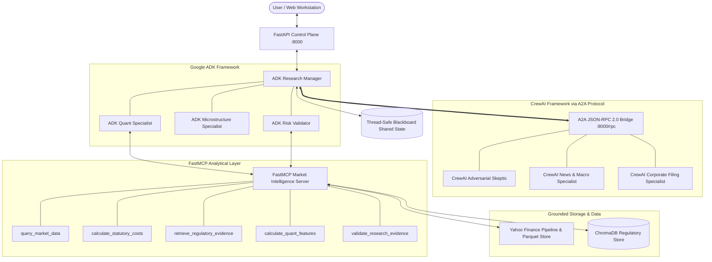

# ArthaAI — System Architecture & Interoperability Specification

## 1. Executive Architecture Overview

ArthaAI is a heterogeneous, multi-agent financial intelligence and quantitative research workstation designed for Indian equity markets (NSE/BSE). It integrates **Google Agent Development Kit (ADK)** and **CrewAI** across an official **Agent-to-Agent (A2A)** JSON-RPC 2.0 protocol bridge, using an in-process **FastMCP** tool server, a thread-safe **Blackboard** shared-state container, and a persistent **ChromaDB** vector knowledge base.

---

## 2. Framework Separation & Persona Registry

ArthaAI strictly restricts multi-agent execution to **Google ADK** and **CrewAI**. No auxiliary frameworks (LangGraph, AutoGen, etc.) are used.

### 2.1. Google ADK Agents
| Agent Identifier | Framework | Primary Responsibility | Input Context | Tools Permitted | Blackboard Output |
| :--- | :--- | :--- | :--- | :--- | :--- |
| `adk_research_manager` | Google ADK | Supervisory decomposition, pipeline orchestration, disagreement reconciliation, Pydantic report synthesis. | User research request, ticker, timeframe, scope. | `ExecutionTracer`, A2A Bridge client. | Final synthesis, audit hash, executive brief. |
| `adk_quant_specialist` | Google ADK | Historical bar ingestion, point-in-time filtering, mathematical indicator computation (returns, vol, SMA, EMA, RSI). | Ticker symbol, PIT cutoff timestamp. | FastMCP `query_market_data`, `calculate_quant_features`. | Verified OHLCV bars, calculated metrics, data citations. |
| `adk_microstructure_specialist` | Google ADK | Bid-ask spread estimation (Corwin-Schultz 2012), Amihud illiquidity, Kyle's lambda, execution slippage bounds. | Quant specialist bars from Blackboard. | Parametric analytical estimators. | Liquidity tier, effective spread, slippage, TWAP recommendation. |
| `adk_risk_validator` | Google ADK | Statutory transaction tax calculations (Finance Act 2024), trading invariant verification (`live_trading_enabled=False`). | Price, quantity, instrument type, Blackboard state. | FastMCP `calculate_statutory_costs`. | STT, GST, Stamp Duty, statutory friction drag %, safety assertion. |

### 2.2. CrewAI Qualitative Specialists
| Agent Identifier | Framework | Primary Responsibility | Transport | Protocol | Blackboard Output |
| :--- | :--- | :--- | :--- | :--- | :--- |
| `crewai_adversarial_skeptic` | CrewAI | Challenges quantitative assumptions, flags lookahead bias, stress-tests tail-risk scenarios. | HTTP / FastMCP | A2A JSON-RPC 2.0 | Counter-arguments, vulnerability analysis, stress scenarios. |
| `crewai_news_macro_specialist` | CrewAI | Macroeconomic indicators, RBI policy stance, inflation regimes, financial news sentiment. | HTTP / FastMCP | A2A JSON-RPC 2.0 | Macro tone, policy rate impact, inflation sensitivity. |
| `crewai_corporate_filing_specialist` | CrewAI | Reviews corporate governance disclosures, SEBI LODR Regulation 30 compliance, and material filings. | HTTP / FastMCP | A2A JSON-RPC 2.0 | Statutory filing notes, auditor remarks, compliance score. |

---

## 3. Mandatory Blackboard Shared-State Architecture

In contrast to brittle peer-to-peer messaging where state is passed informally between agent arguments, ArthaAI implements a formal, versioned, thread-safe Blackboard (`src/arthaai/orchestration/blackboard.py`).

### 3.1. Blackboard Namespaces
1. `REQUEST`: Canonical research intent and normalized parameters (`symbol`, `as_of_time`, `scope`).
2. `MARKET_DATA`: Observed historical prices, volume series, and quantitative indicators.
3. `RAG_EVIDENCE`: Retrieved passages and chunk citations from the ChromaDB store.
4. `AGENT_CONTRIBUTIONS`: Structured `AgentContribution` objects produced by specialists.
5. `TOOL_RESULTS`: Raw and sanitized outputs from FastMCP tool executions.
6. `VALIDATION`: Input/output guardrail verdicts and SEBI compliance checks.
7. `GOVERNANCE`: Immutable system safety rules (e.g., `live_trading_enabled = False`).

### 3.2. Architecture Invariants
- **Monotonic Versioning**: Every write increments an integer version, producing a complete audit trail of mutations.
- **Consumer Lineage Tracking**: Reading an entry with a `consumer_id` registers that agent in `entry.consumers`, creating provable context transfer.
- **Safety Immutability**: Cells marked `is_immutable=True` reject overwrite attempts with `PermissionError`, preventing malicious or hallucinated agents from disabling safety guardrails.
- **Disk Persistence**: Serializes complete run states to `data/blackboard/{run_id}.json` upon execution milestones.

---

## 4. Model Context Protocol (FastMCP) Integration

ArthaAI connects analytical tools using the official **Model Context Protocol (FastMCP)** via `src/arthaai/mcp/server.py`:

1. `query_market_data`: Point-in-time filtered historical OHLCV queries over DuckDB/Parquet storage.
2. `calculate_statutory_costs`: Exact statutory friction calculation implementing the **Finance (No. 2) Act 2024** schedule (0.1% STT on delivery, 0.02% on futures post-Oct 2024, 0.015% stamp duty, 18% GST).
3. `retrieve_regulatory_evidence`: Grounded semantic retrieval from ChromaDB regulatory repository.
4. `calculate_quant_features`: Mathematical calculations for returns, realized volatility, SMA, EMA, and RSI.
5. `validate_research_evidence`: Audit trail checking citations against indexed Parquet and RAG registries.

---

## 5. Agent-to-Agent (A2A) Protocol Implementation

Inter-framework communication between Google ADK and CrewAI uses the official `a2a-sdk` (JSON-RPC 2.0):

- **Discovery Route**: `/.well-known/agent-card.json` serving the compliant `AgentCard` schema declaring capabilities, interfaces, and authentication constraints.
- **RPC Endpoint**: `/rpc` handling standard `SendMessageRequest` payloads with `task_id` tracking.
- **Task Lifecycle**: Transitions strictly through `SUBMITTED` &rarr; `WORKING` &rarr; `COMPLETED` (or `FAILED` on timeout/network exception).
- **Artifact Returns**: Results are serialized into `TaskArtifactUpdateEvent` containing the typed `AgentContribution`.
